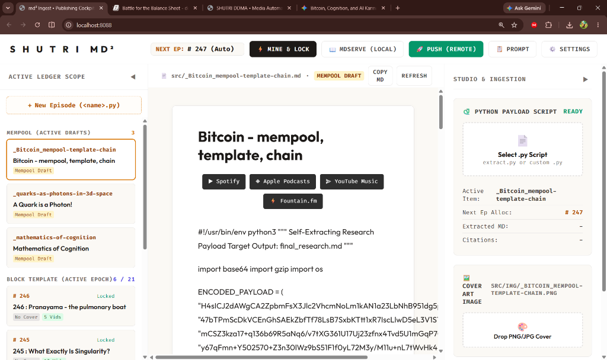

# md² (The mdd Engine & Publishing Cockpit)

> **md²** (pronounced *md-squared*) stands for **mdBook deepDive**. Much like `vim` is a recursion of `vi`, **md²** is a recursive evolution of the `mdbook` ecosystem, transformed into an opinionated, multi-modal publishing web application for the **Personal Knowledge Blockchain**.

---



---

## The Philosophy: Personal Knowledge Blockchain

In the age of LLMs, the cost of generating information has collapsed to zero, but the cost of maintaining **Signal** has skyrocketed. Most research dies in transient chat windows. 

**md²** provides a formal framework to organize research into an immutable ledger of discovery:

* **Block 0 (The Genesis Block):** The hardcoded rules of your universe. It contains the **Six Foundational Pillars** (e.g., Bitcoin, Intelligence, Physics) that anchor all subsequent research.
* **Knowledge Blocks (Block 1, 2, ...):** Chronological epochs of discovery. Each block is limited by the **Law of 21**; once the 21st episodic transaction is mined, the block is sealed into the permanent chain.
* **The Mempool:** The volatile staging zone for unmined research drafts (`src/_<slug>.md`).
* **The Block Template:** The active mining epoch holding verified episodes awaiting block seal.

---

## 🤖 1-Prompt Setup for Antigravity & AI Assistants

If you are setting up `mdIngest` in a new workspace using **Antigravity** or another AI coding assistant, copy and paste this prompt to configure the complete publishing stack automatically:

```text
Please set up and verify the complete publishing environment (mdIngest + DDMA) in this workspace. Do every step below in order. Do not skip a step. If a step fails, fix it and continue — do not stop and ask unless a step explicitly says to ask.

1. Verify the toolchain: Python 3.10+, Cargo/Rust, mdbook (v0.5.0+), and mdbook-katex are installed and available on PATH. If mdbook or mdbook-katex are missing, install them via `cargo install mdbook mdbook-katex`.
2. Install the Python packages for mdIngest: from the mdIngest repo root, run `pip install -r ui/requirements.txt` (faster-whisper, av, openai-whisper, numpy — required for transcription; the server starts without them but transcription fails).
3. Install the Python packages for DDMA: from the ddma repo root, run `pip install -r requirements.txt` (faster-whisper, av, manim, google-generativeai, pyyaml, and the rest).
4. Verify ffmpeg is installed and on PATH (`ffmpeg -version`). If it is missing, install it (Windows: `winget install ffmpeg` or `choco install ffmpeg`; macOS: `brew install ffmpeg`; Linux: `sudo apt install ffmpeg` or the distro equivalent). The pipeline cannot compile audio or video without ffmpeg.
5. Build the md-publish preprocessor binary from the mdIngest repo root using `cargo build --release` (the manifest is the repo-root `Cargo.toml`; the binary source is `crate/src/main.rs` — do NOT run the build inside `crate/`, there is no manifest there).
6. Verify the built binary exists at `target/release/md-publish`. Do NOT require `[preprocessor.katex]` or `[preprocessor.ingest]` blocks in the repo-root `book.toml` — that file intentionally has no preprocessors enabled (for manual-build stability); the preprocessor is wired in at publish time.
7. Set up the workspace folder. The user creates an empty folder on Google Drive to be the workspace (ask the user for the folder, or use the folder ID from its Drive URL `https://drive.google.com/drive/folders/<FOLDER_ID>`). Then mount it as a local path — the code only does local file I/O against a local path, never the Google Drive web API:
   - On Windows or macOS: use Google Drive for Desktop. Install it and sign in if it is not already installed. The mount appears at `G:\My Drive\` on Windows, or `~/Library/CloudStorage/GoogleDrive-<email>/My Drive` on macOS. Do NOT use rclone on Windows or macOS.
   - On Linux or WSL: use rclone (Google offers no Drive client for Linux). Install rclone, run `rclone config` to create a Drive remote named `gdrive` (complete the browser sign-in), then mount only the workspace folder by its ID: `rclone mount gdrive: /mnt/gdrive/workspace --drive-root-folder-id <FOLDER_ID> --vfs-cache-mode full --daemon`. On WSL, prefer this native Linux mount over `/mnt/g` (the Windows Drive mount is slow through the WSL bridge, especially for ffmpeg); use `/mnt/g/My Drive/<folder>` only as a fallback if the rclone mount is not possible. If `rclone mount` is not possible at all (no FUSE), use `rclone copy` instead: keep a plain local folder, set the workspace path to it, and copy files to/from Drive with `rclone copy` (pull before working, push after).
   - In Docker or a VM: use rclone as on Linux (there is no desktop app in a container).
   - Create the folder structure inside the mounted workspace folder if any are missing: `episodes/`, `vault/`, `inputs/`, `audio/`, `video/`, `mosaics/`, `manims/`, `rules/`.
   - Set the `DD_HUB_ROOT` environment variable to the mounted workspace path and persist it (shell profile, systemd unit, or Docker entrypoint) so it survives new shells.
8. Set up settings: create `<workspace>/vault/settings.json` from `settings.template.json` (in the mdIngest repo root) if it does not exist. Fill in API keys only if the user provides them; never commit settings.json. If the user already has a settings.json in an existing workspace folder, copy that file into the new workspace folder's `vault/` instead of creating one from the template.
9. Launch the mdIngest Publishing Cockpit server (`python ui/server.py` from the mdIngest repo, or `./start_ui.bat` on Windows) on http://localhost:8088 and verify that http://localhost:3000 is accessible via `mdbook serve`.
10. Launch the DDMA Clip Studio (Curator) server: from the ddma repo root, run `python scratch/run_curator.py` and verify http://localhost:8000/curator.html loads.
11. Launch Beats Studio from the mdIngest landing page (http://localhost:8088/, the "Launch Beats Studio" button) and verify http://localhost:8001 responds.
12. Verify: `DD_HUB_ROOT` resolves, the workspace folder structure exists, `episodes/<N>/plan.json` is readable for an existing episode (or the workspace folder is empty for a fresh workspace), and all three servers respond (cockpit :8088, Curator :8000, Beats :8001).
```

---

## The md² Publishing Cockpit (Web Application)

`mdIngest` includes a standalone, zero-dependency desktop web application styled in the **Shutri.com Minimalist Editorial design system** (`#fbf9f5` warm sand canvas, `#e7e5e4` stone borders, `#d97706` amber accents, and `#1c1917` ink typography).

### 1. 3-Pane Modular Workspace

* **Left Pane (Active Ledger Scope):**
  * **Mempool Drafts:** Visual list of active drafts (`src/_<slug>.md`) with live status indicators.
  * **Two-Way Inline Title Editor:** Hover `✏️` or double-click to edit summary titles with real-time 5-word limit badges. Auto-saves and synchronizes `SUMMARY.md` instantly.
  * **Draft Management:** 1-Click `🗑️` deletion for unmined drafts with automatic tree reconciliation.
  * **Block Template & Chain Archive:** Visual inspection of active epoch episodes and historical Genesis blocks.
  * **Collapsible & Expandable:** Toggle via edge tabs (`LEDGER` / `STUDIO`) or keyboard shortcuts (`[` and `]`).

* **Central Pane (Live Editorial Preview):**
  * **Absolute KaTeX Pipeline:** High-fidelity mathematical formula rendering ($\mathbb{R}, \mathbb{C}, \mathbb{H}, \mathbb{O}$, Dirac spinors, quaternions, and matrices) with delimiter hardening.
  * **Clean Paper Typography:** Seamless reading experience matching physical book aesthetics.
  * **Podcast Syndication Strip:** Live preview links for Spotify, Apple Podcasts, YouTube Music, and Fountain.fm.

* **Right Pane (Studio & Ingestion):**
  * **Lossless `.py` Payload Extractor:** AST-driven Python script unpacker with live metadata diagnostics and citation counters.
  * **Single-Asset Store Discovery:** Automatically discovers 740×740 square video clips and cover art across both `src/vid/` and DDMA single-asset archives.

* **Top Command Bar:**
  * **`⚡ Mine & Lock`:** 1-Click atomic mining—allocates the next sequential episode number (e.g. `# 247`), updates `SUMMARY.md`, and moves the draft into the Block Template.
  * **`🟢 mdserve:3000` (Two-Way Toggle):** Starts/stops the local `mdbook serve` process on `0.0.0.0:3000` with live port probing.
  * **`🚀 Push (Remote)`:** Stages, commits, and pushes changes to your remote Git repository with automated semantic messages.
  * **`📋 Prompt`:** One-click clipboard copy of the canonical Master Packaging Prompt.
  * **`⚙️ Settings`:** Manage podcast URLs and publishing word limits.

---

## Dependencies & System Requirements

The 1-Prompt Setup above verifies and installs the full toolchain (Python 3.10+, Cargo/Rust, mdbook, mdbook-katex, Python packages, ffmpeg).
---

## Setting up the workspace folder

Create an empty workspace folder on Google Drive. Then copy the 1-Prompt Setup below into an AI assistant and let it do the rest — mounting the folder, creating the subfolders, installing the toolchain, and setting up settings.
---

## Quick Start: Launching the Cockpit
First-time setup is the 1-Prompt Setup above, not this section.


### Windows 1-Click Launcher
Double-click `start_ui.bat` or run:
```cmd
start_ui.bat
```

### Universal Launch (macOS / Linux / Windows)
```bash
python ui/server.py
```
This opens the workspace landing page at `http://localhost:8088/` — the workspace home (workspace picker, launcher for mdIngest + DDMA + Beats Studio, and the single drop point for new inputs). The Publishing Cockpit is at `http://localhost:8088/cockpit.html`.

---

## The Master Packaging Prompt

*Copy this into Google Gemini, Claude, or ChatGPT to generate a 100% lossless self-extracting payload:*

```text
Objective: Package the complete exhaustive research from this session into a self-extracting Python script without summarizing or pruning.

1. Packaging Requirements:
* Full Fidelity: Package the exhaustive research in its entirety. Do not summarize or prune.
* Absolute KaTeX: Wrap all mathematical notation and symbols in Absolute KaTeX delimiters: $...$ for inline and $$...$$ for block displays. Never leave whitespace adjacent to '$'. Escape financial dollar amounts as \$ (e.g. \$100M).
* Hyperlinked Bibliography: Format every entry in the "Works Cited" section as a clickable Markdown link: [^N]: [Author, Title, Year](URL).
* Title Header: Ensure the document begins with a strict H1 title adhering to a 5-word maximum limit: # [Title].

2. Python Script Format:
Create an executable Python script where the full exhaustive research markdown is stored in raw_markdown:

raw_markdown = """
# [Title]

[Insert complete exhaustive markdown research here with $inline$ and $$block$$ math and [^1] citations...]
"""

if __name__ == '__main__':
    with open('final_research.md', 'w', encoding='utf-8') as f:
        f.write(raw_markdown)
    print("✅ Extracted final_research.md successfully.")
```

---

## The Underlying Rust Preprocessor (`md-publish`)

The 1-Prompt Setup above builds the `md-publish` binary (`cargo build --release` from the repo root — NOT inside `crate/`, there is no manifest there). This section remains only as a reference for headless builds.


---

## Safety & Integrity Mechanisms

To ensure `SUMMARY.md` is never corrupted:
1. **Automated Pre-Write Backups:** `server.py` writes rolling timestamped snapshots to `ingest/backups/SUMMARY_<timestamp>.md.bak` before every write.
2. **Surgical AST Section Isolation:** Reconstructs Mempool and Block Template sections while keeping Genesis Pillars and Header links 100% immutable.
3. **Git Atomic Versioning:** Every transaction is tracked in Git with 1-click rollback.

---

## 🐛 Bug tracking

We do **not** manage issues on GitHub. Bugs and fixes for mdIngest, the deepDive pipeline, DDMA, and the portfolio app are tracked in the [Bug Tracker Space](https://muse.ai/s/bug-tracker-ixe6daxhoezyxy/g1O341vEl5aXYIzWFP1db5l-xunGJAxBRSwSJccC110) — a read-only list of all bugs with their status.

---

## License
Licensed under the [MIT License](LICENSE).
